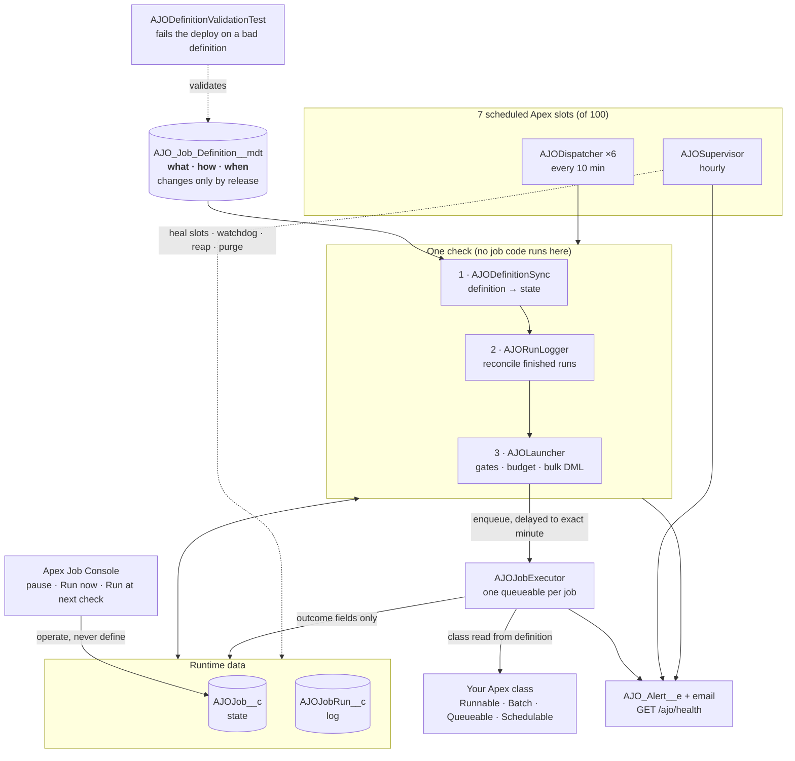
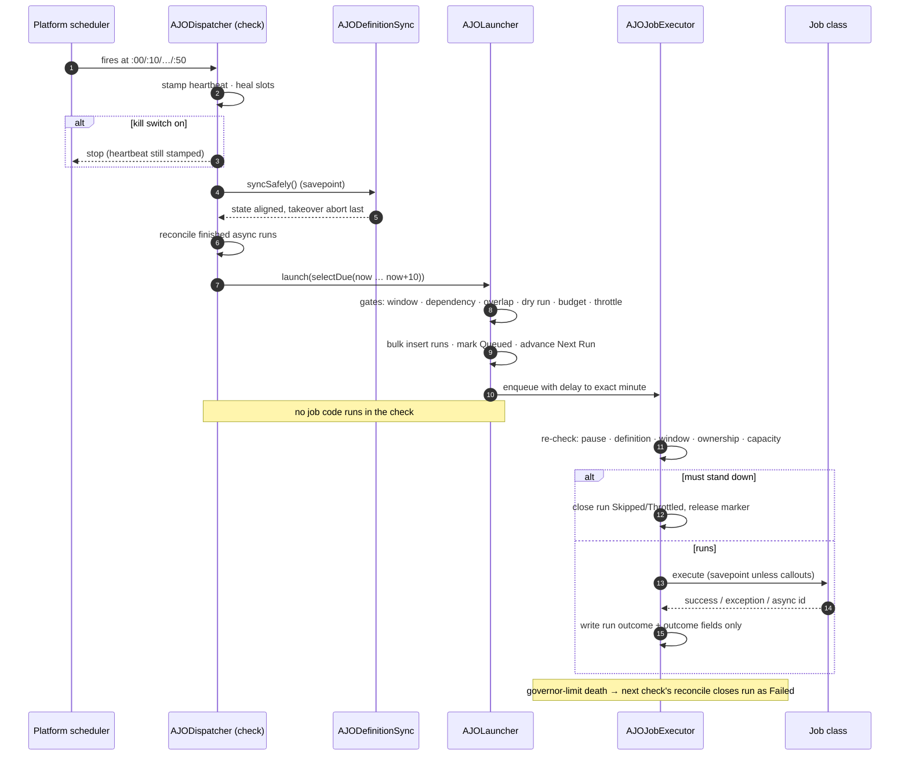
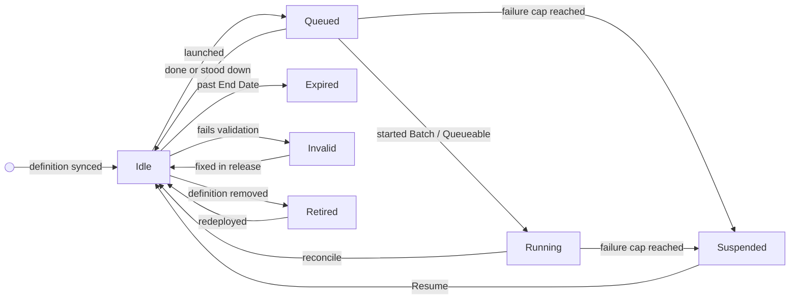

# Architecture

## The problem

Salesforce allows 100 scheduled Apex jobs per org, shared with integrations and managed packages.
The usual pattern — one `Schedulable` wrapper and one cron entry per job — turns that limit into a
release blocker. The limit counts **cron entries**, not jobs. AJO schedules a small, fixed set of
entries and describes the jobs as data.

## At a glance



Diagram sources and PNG renderings live in [`docs/diagrams`](diagrams/) (`overview`, `check`,
`states`).

## The hybrid model

| Layer | Object | Changes by | Holds |
| --- | --- | --- | --- |
| Definition | `AJO_Job_Definition__mdt` | **Release** (PR, review, deploy) | What runs, how, when: class, execution type, cron, time zone, scope, parameters, window, policies, dependencies, takeover target |
| State | `AJOJob__c` | The engine (and the console's operate actions) | Next run, status, last outcome, failure count, queued marker, operations pause, takeover audit |
| Log | `AJOJobRun__c` | The engine | One row per run or refusal |
| Settings | `AJOSetting__c` | Admin | Framework-wide switches and limits |

Why both: custom metadata gives a release trail, deploy-time validation and no privilege escalation
(nobody can point the scheduler user at an arbitrary class by editing a record), but it cannot hold
runtime state — writing it means an asynchronous Metadata API deployment. So definitions are custom
metadata and state is a custom object keyed by the definition's `DeveloperName` (`AJO_JobKey__c`).

`AJODefinitionSync` keeps them aligned. It runs at the start of every check, so a deployment takes
effect within ten minutes, and it is idempotent: it only writes rows that changed.

Security property: projected definition fields on `AJOJob__c` are read-only in both permission
sets, the sync overwrites any direct edit it finds (it compares the record's *current values* with
the definition, not just a stored hash), and the executor reads the class, type, scope and
parameters from the definition at run time. A record edit can never change what runs.

## Slots

```
AJO Heartbeat 00   0 0  * * * ?    AJODispatcher(0)
AJO Heartbeat 10   0 10 * * * ?    AJODispatcher(10)
...                                ...
AJO Heartbeat 50   0 50 * * * ?    AJODispatcher(50)
AJO Supervisor     0 5  * * * ?    AJOSupervisor         (hourly)
```

`System.schedule` takes one value in the minutes field, so a ten-minute rhythm needs six entries.
Ten minutes, not five, because the platform caps a queueable delay at ten minutes and a check must
be able to reach any minute in its window: six slots give minute precision where twelve slots in a
five-minute design give five-minute marks.

## A check, step by step (`AJODispatcher.run`)

1. **Stamp** `AJO_LastHeartbeatAt__c` (also while paused — the watchdog measures the scheduler).
2. **Heal**: re-create any missing heartbeat or the supervisor (`AJOInstaller.healSafely`). Checks
   heal each other every ten minutes. Nothing is re-created after a deliberate uninstall.
3. Stop if **every job is paused** (kill switch).
4. **Sync** definitions inside a savepoint (`syncSafely`); a failure is rolled back and alerted and
   the check continues with the previous state.
5. **Reconcile** finished async runs against `AsyncApexJob`, so the overlap gate sees fresh status.
6. **Select** due jobs with an indexed query: active window by real date comparisons, managed only
   (unless the migration switch is on), not Suspended/Expired/Retired/Invalid, `Next Run <= now +
   10 min` (or `<= now` with deferral off). Ordered by priority then due time; at most 200.
7. **Dispatch** (`AJOLauncher.launch`): gates per job, then one executor per job. **No job code
   runs in the check's transaction.**
8. **Flush alerts**.



### Gates, in order

| Gate | Outcome when refused |
| --- | --- |
| Suspended | silently skipped (alerted when it was suspended) |
| Definition policy (managed, or migration switch on) | `Skipped` run, advance |
| Activation window | `Skipped`, advance |
| Dependency: parent's latest finished run succeeded **after this job last ran** | `Skipped`, advance |
| Overlap: previous occurrence still `Queued`/`Running` | `Skipped`; advance unless policy is Queue |
| Dry run | `Dry Run`, advance |
| Launch budget | held silently; Next Run untouched; `LAUNCH_BACKLOG` alert |
| Batch throttle | `Throttled`; Next Run untouched (next check retries) |

The budget is checked before the throttle, so a job held for the budget never takes batch capacity
that this check would then leave unused.

### Bulk and bounded

The check costs a fixed number of DML statements however many jobs are due: one insert for all run
records, one update to attach executor ids, one insert for refusal notes, one update for job rows
(plus the heartbeat stamp and any sync writes). Launches are capped at
`min(AJO_MaxLaunchesPerCheck__c [40], queueable limit − used − 2)`. Jobs over the budget keep their
Next Run and are taken by the next check: **late by one interval, never early, never lost.**

## The executor (`AJOJobExecutor`)

A `Queueable, Database.AllowsCallouts` per job, delayed (0–10 minutes) to the job's exact minute.

Before running it re-checks, in this order, and stands down with a `Skipped` run and the reason:
kill switch; definition policy; definition still deployed, active; operations pause; activation
window; Suspended/Expired/Retired/Invalid; **ownership** of the occurrence (an edit, resume or
resync after queueing hands the occurrence back to the heartbeat — running it here too would run it
twice). For batch work it re-claims capacity; if full, it records `Throttled` and hands the
occurrence back.

Then it overlays the definition onto the job and runs it. The overlay is inside the job's
try/catch: a definition removed, deactivated or invalid between queueing and starting is recorded as
a `Failed` run, never an uncaught executor failure that leaves the job marked `Queued`.

| Execution type | How it runs | Outcome known |
| --- | --- | --- |
| `Runnable` (`AJORunnable`) | `run(AJOContext)` in the executor transaction | immediately, or when `ctx.asyncJobId` work finishes |
| `Batch` | `Database.executeBatch(instance, scope)` | when the batch finishes (reconcile) or `AJORunLogger.report()` from `finish()` |
| `Queueable` | `System.enqueueJob(instance)` | when the queueable finishes (reconcile) |
| `Legacy Schedulable` | `execute(null)` in the executor transaction | immediately |

**Savepoint.** Unless the definition declares `Allows Callouts`, the job runs inside a savepoint; if
it throws, its partial DML is rolled back before the failure is recorded. A savepoint blocks
callouts, so a callout job owns its own partial-failure handling.

**No DML before the job.** The run record was inserted by the check (a previous transaction), so a
callout job can call out immediately.

**Committing the outcome.** The executor read the job row when it started, and a job can run for
minutes. It therefore writes back **only the fields a run changes** — last run time, status and
duration, async job id, failure count — and writes Status only if the run changed it. It never
writes Next Run or the schedule, and clears the queued marker only if it owned that occurrence. A
sync, an edit or a later check that changed the row meanwhile is never overwritten, so an occurrence
is never lost or repeated by a stale write.

**Uncatchable failures.** A governor-limit exception kills the executor's transaction, including its
bookkeeping. The platform marks the queueable `Failed`; at the next check `AJORunLogger.reconcile`
sees a run still pointing at a finished `AJOJobExecutor` and closes it as `Failed` ("ended without
recording an outcome"), counting it against the circuit breaker. Nothing fails silently.

**Running user.** Heartbeat launches run as the scheduling user. Console **Run now** runs as the
clicking user (in its own transaction); **Run at next check** makes the job due so the next check
runs it as the scheduling user. **Run now is refused while the job is `Queued` or `Running`** unless
its overlap policy is `Allow`, so a click cannot start a second copy of a job in flight.

## Outcomes and the circuit breaker

`AJORunLogger.settleJobs` writes last-run fields, resets or increments the failure count, suspends at
`Max Consecutive Failures` (alert `JOB_SUSPENDED`), raises `JOB_FAILED` (emailed to the job's Notify
Emails), retires jobs whose window closed mid-run, and keeps a `Queued` job queued (its next
occurrence is already waiting). On success it **chains** dependents that set `Run After
Dependency`: their Next Run becomes now, so they start at the next check.

Job status (`AJOJob__c.AJO_Status__c`):



## Batch capacity (`AJOThrottle`)

Two limits, counted separately: **active** batches (`Queued`, `Preparing`, `Processing`; the platform
runs five) against `AJO_MaxConcurrentBatches__c`, and the **flex queue** (`Holding`, at most 100)
against `AJO_FlexQueueCap__c` (default 90). Only `Batch` jobs consume capacity.

## Supervisor (hourly, `AJOSupervisor`)

Each step in its own savepoint and try/catch — one failure is rolled back and alerted, the rest run:

1. heal (first, so self-healing is never skipped) · 2. watchdog (`HEARTBEAT_STALE`) · 3. sync ·
4. reconcile · 5. reap overrunning runs **and abort their async job** · 6. expire past End Date ·
7. clear lapsed queue markers · 8. start `AJOPurgeBatch` (retention in 2,000-row chunks).

## Alerts

`AJO_Alert__e` (high-volume, publish-immediately, so alerts survive the rollback of the transaction
that raised them) plus email for WARNING/ERROR to `AJO_DigestEmail__c` and the job's Notify Emails.
Codes: `JOB_FAILED`, `JOB_SUSPENDED`, `DEFINITION_INVALID`, `DEFINITION_RETIRED`, `CUTOVER_DONE`,
`CUTOVER_FAILED`, `HEARTBEAT_STALE`, `SLOTS_REARMED`, `SYNC_FAILED`, `RECONCILE_FAILED`,
`MAINTENANCE_FAILED`, `LAUNCH_BACKLOG`. Buffered and sent once per transaction; deduplicated by code
and job.

In-org alerting cannot report its own total failure (a deactivated scheduling user stops every check
and the supervisor). `GET /services/apexrest/ajo/health` returns 200/503 for an external monitor.

## Guarantees

- A job never starts before its minute (deferral rounds up; with deferral off only due jobs are taken).
- An occurrence is run at most once (ownership check; Next Run advanced past a queued occurrence).
- A takeover never leaves a job run by both the Setup schedule and the orchestrator, or by neither
  (state write and abort in one transaction, abort last, savepoint). `CUTOVER_DONE` is raised only
  after the abort succeeds, so a rolled-back takeover is never announced.
- A run's write-back never overwrites scheduling state that changed while it ran.
- A manual run honours the overlap policy.
- One job's failure — including a governor limit — never affects another job or the check.
- Every refusal and failure leaves a run record or an alert.

## Limits and trade-offs

- **Granularity**: minute precision; nothing faster than once per minute per job, and the
  scheduler as a whole wakes every ten minutes.
- **Throughput**: ~40 launches per check (240/hour) by default; more due at once start one interval late.
- **Running user**: all scheduled jobs run as one user. Review sharing for each job before moving it.
- **Legacy Schedulable** classes run inline in the executor; async work they start themselves is not
  tracked. Register the batch class directly or implement `AJORunnable` and set `ctx.asyncJobId`.
- **Managed packages** that schedule themselves keep their own slots.
- **Cron**: Quartz subset; `L`, `W` and `#` are refused by validation.
